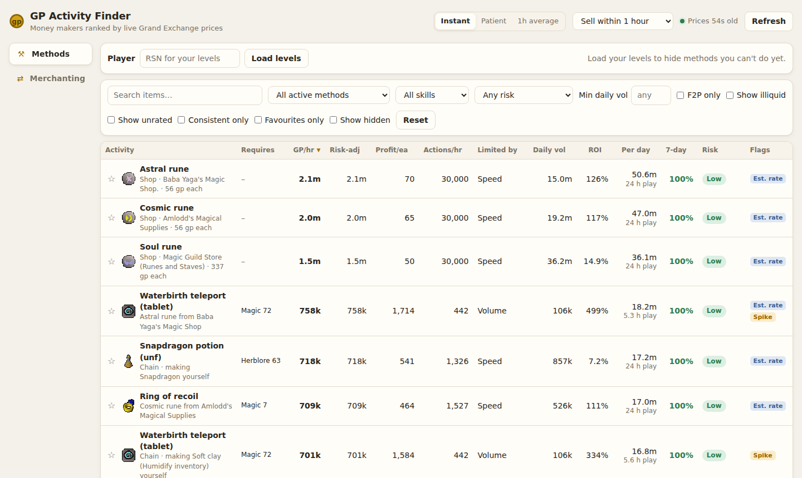
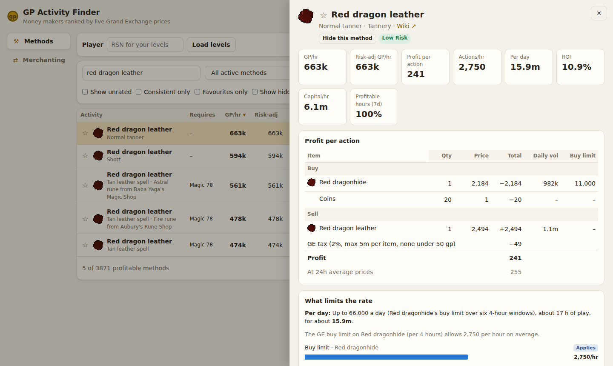
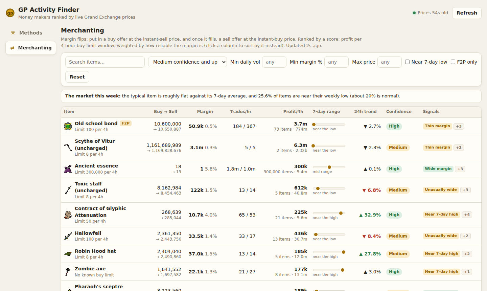

# OSRS GP Activity Finder

A local web app that ranks Old School RuneScape money makers by **live Grand Exchange prices**:
processing items (crafting, fletching, herblore, smithing…), high alchemy, NPC shop resales,
potion decanting, item sets, two-step chains and margin flips. It focuses on market methods,
not bossing: the obscure recipe that currently sells for far more than its ingredients.



It runs entirely on your machine. A small Python server pulls prices and recipe data from the
OSRS Wiki, works out profit, rate and risk for every method, and serves a React UI at
`http://localhost:8000`.

## Features

**Methods page**
- Every GE-tradeable recipe from the wiki, plus high alchemy, NPC shop → GE resales, Bob Barter
  decanting, GE item sets, two-step chains (make the intermediate yourself) and recipes with an
  ingredient bought from a shop.
- **GP/hr** that's honest about real limits: inventory trips and banking, GE buy limits, and
  how much the market can absorb (10% of an item's trade volume).
- **Per day**: what a method can earn in a day before the market runs out, and the play time
  that takes. Finds "buy all day, process in 3 minutes" methods that GP/hr undersells.
- Risk (ROI, break-even move vs price volatility), a **7-day consistency** score, and flags for
  stale prices, margin spikes, thin markets and estimated rates.
- Filters: type, skill, risk, minimum daily volume, F2P only, consistent only, favourites, hidden.
- **Your levels**: enter your RSN to hide (or grey out) methods you can't do yet.
- Price modes (instant / patient / 1h average) and a **sell within** window for steady methods.
- A detail view per method: profit breakdown, every rate limit, 7-day price and volume charts,
  and the assumptions behind the numbers.



**Merchanting page**
- Margin flips ranked by profit per 4-hour buy-limit window, using each side's trade volume to
  estimate how fast your buy and sell offers fill.
- Signals: wide or thin margin, busy or one-sided market, fills the buy limit, steady or
  unusually wide margin, near the 7-day low or high, rising or falling, and stale quotes, plus a
  market-wide banner so a dip on one item can be told apart from the whole GE sliding.



## Requirements

| Tool | Version | Install |
|------|---------|---------|
| Python | 3.12 or newer | [python.org](https://www.python.org/downloads/) (or your package manager) |
| uv | any recent | `curl -LsSf https://astral.sh/uv/install.sh \| sh` ([docs](https://docs.astral.sh/uv/getting-started/installation/)) |
| Node.js + npm | 20 or newer | [nodejs.org](https://nodejs.org/) (only needed to build the UI) |

Works on Linux, macOS and Windows (WSL recommended on Windows). Needs an internet connection to
reach the OSRS Wiki.

## Build and run

```bash
# 1. Get the code
git clone https://github.com/Wartimegaming/osrs-gp-activity-finder.git
cd osrs-gp-activity-finder

# 2. Install the Python dependencies (creates .venv)
uv sync

# 3. Build the web UI (produces frontend/dist, which the server serves)
cd frontend
npm ci
npm run build
cd ..

# 4. Start the server
uv run python -m backend serve
```

Then open **http://localhost:8000**. Stop the server with `Ctrl+C`.

### First run

The first start takes a few minutes to be fully ready. Everything happens in the background and
the page works throughout:

1. **A few seconds:** item list, recipes, item sets, NPC shops and live prices load.
2. **About 3 minutes:** a week of hourly price history is backfilled (one request per second).
   Until it finishes, daily volumes, the 7-day columns and charts are incomplete.
3. **Once only, if needed:** any item icons missing from `assets/icons/` are downloaded slowly in
   the background. The repo already includes them, so normally there's nothing to fetch.

Everything is stored in `data/osrs.db` (SQLite, not committed). Later starts reuse it. To start
from scratch, stop the server and delete the `data/` folder.

### Server options

```bash
uv run python -m backend serve --port 8080         # a different port
uv run python -m backend serve --host 0.0.0.0      # reachable from other devices (no login!)
uv run python -m backend serve --no-refresh        # don't fetch anything; use the data you have
OSRS_DB_PATH=/path/to/other.db uv run python -m backend serve   # a different database file
```

### Updating

```bash
git pull
uv sync
(cd frontend && npm ci && npm run build)
```

Then restart the server.

## How it stays up to date (and stays polite)

The app relies on free community services, so it fetches as little as it can:

| Data | When | From |
|------|------|------|
| Live prices | Every 60 s, **only while the UI is open** | OSRS Wiki real-time prices API |
| Hourly price snapshots | Once an hour | OSRS Wiki real-time prices API |
| Item list, buy limits | Daily | OSRS Wiki real-time prices API |
| Recipes, item sets, NPC shops | Weekly | OSRS Wiki (Bucket API and page text) |
| Item icons | Once per icon, ever | OSRS Wiki images → `assets/icons/` |
| Your levels | Only when you load a player (cached 5 min) | Official OSRS hiscores |

Every request uses gzip and an identifying User-Agent. The browser never contacts the wiki
directly; icons are served by the app. **If you fork this project, change `USER_AGENT` in
[`backend/config.py`](backend/config.py) to your own project URL or contact**, as the
[wiki's API guidelines](https://oldschool.runescape.wiki/w/RuneScape:Real-time_Prices) ask.

## How the numbers are worked out

In short:

```
profit per action = what you sell − GE tax − what you buy        (live prices)
actions per hour  = the lowest of: your speed (ticks + banking), GE buy limits,
                    and 10% of each item's hourly trade volume
GP/hr             = profit per action × actions per hour
per day           = profit × what the market allows in a day, with the play time it takes
```

Speeds come from the wiki's tick counts plus banking estimates; anything assumed is flagged
**Est. rate**. The full model (tax rules, volume filters, risk, consistency, shops, chains,
merchanting signals) is in [docs/PROJECT_SPEC.md](docs/PROJECT_SPEC.md).

## Adjusting the assumptions

- **Per-method fixes** go in [`backend/overrides.toml`](backend/overrides.toml): a measured
  `actions_per_hour`, missing ticks, an efficiency, excluding a recipe, name aliases, items that
  stack, potion families to decant, and shops to ignore. Each recipe's detail view shows its
  override key. Changes apply on the next recipe refresh (`uv run python -m backend ingest recipes`).
- **Global defaults** (banking time, efficiency, market share, volume thresholds, risk cut-offs,
  shop hop time) are in [`backend/engine/settings.py`](backend/engine/settings.py).

## Command line

The same data and rankings work without the UI:

```bash
uv run python -m backend ingest all        # refresh items, prices, recipes, sets and shops now
uv run python -m backend backfill          # fetch any missing hourly snapshots from the last 7 days
uv run python -m backend report --unmatched 20
uv run python -m backend rank              # top 25 methods by GP/hr
uv run python -m backend rank --sort daily --min-volume 10000 --top 50
```

`rank` options: `--mode instant|patient|average`, `--sell-hours 1|4|12|24`,
`--sort gp_hr|risk_adjusted|daily`, `--type recipe|alch|decant|set|shop|chain|flip`
(flips only when asked for), `--min-consistency 0.8`, `--min-volume N`, `--f2p`,
`--max-risk low|medium|high`, `--include-illiquid`, `--search TEXT`, `--top N`.

Individual refresh jobs: `ingest mapping | latest | hourly | recipes | sets | shops | icons`.

## Development

```bash
uv run python -m backend serve     # API and background refresh on :8000
cd frontend && npm run dev         # UI with hot reload on http://localhost:5173 (proxies /api to :8000)
```

Checks:

```bash
uv run pytest                      # backend tests
cd frontend && npm run lint        # frontend lint
cd frontend && npm run build       # type-check and build
```

Project layout:

```
backend/
  ingest/      fetching: prices, item list, recipes, item sets, shops, icons
  engine/      the model: profit, rates, risk, consistency, shops, chains, merchanting
  api/         FastAPI app, background scheduler, hiscores
  overrides.toml
frontend/      React + Vite + TypeScript UI (TanStack Table / Query)
assets/icons/  cached item icons
docs/          specification and screenshots
tests/         pytest suite
```

## Troubleshooting

- **The page says "Frontend not built"**: run `npm ci && npm run build` in `frontend/`, then
  reload. (Or use the dev server on port 5173.)
- **`localhost:8000` doesn't open from Windows when running in WSL**: start the server with
  `--host 0.0.0.0` and open `http://<your WSL IP>:8000` (find it with `hostname -I`).
- **Port already in use**: pick another with `--port 8080`.
- **Most methods show "Illiquid" or no 7-day data**: the history backfill is still running
  (about 3 minutes on first start); the header shows when it's done.
- **Numbers look wrong for one method**: open it and check the flags and assumptions; a
  `Check` or `Est. rate` flag usually explains it. Fix the speed in `backend/overrides.toml`.

## Disclaimer and credits

- This is an unofficial fan project, **not affiliated with or endorsed by Jagex**. It only reads
  public data and suggests methods; it never interacts with the game client or automates
  anything. Prices move: check them in game before committing a lot of GP.
- Prices come from the [OSRS Wiki real-time prices API](https://oldschool.runescape.wiki/w/RuneScape:Real-time_Prices).
  Recipe, item set and shop data come from the [Old School RuneScape Wiki](https://oldschool.runescape.wiki/),
  licensed under [CC BY-NC-SA 3.0](https://creativecommons.org/licenses/by-nc-sa/3.0/).
- Item icons are © Jagex Ltd., obtained from the OSRS Wiki. Old School RuneScape is a trademark
  of Jagex Ltd.

## License

The code is licensed under the [GNU General Public License v3.0](LICENSE) (GPL-3.0-only): you
can use, change and share it, and anyone who distributes a modified version must release it under
the same license. This covers the code only. The item icons (© Jagex Ltd.) and the data from the
OSRS Wiki keep their own terms, described above.
